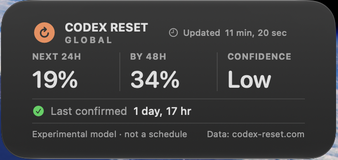

# Codex Reset for macOS

Native macOS app and medium-only widget for global reset estimates from [codex-reset.com](https://codex-reset.com/). Estimates are experimental, and the app uses public data only.

## Screenshots

## Install

[Download the latest release](https://github.com/kxrxh/codex-reset-macos/releases/latest), unzip it, and move `Codex Reset.app` to Applications. Open the app, then add the **Medium** widget from Notification Center → **Edit Widgets**.

The app is not notarized, so macOS may ask you to confirm the first launch.

## Build

Open `CodexResetWidget.xcodeproj` in Xcode and run the `CodexReset` scheme.
