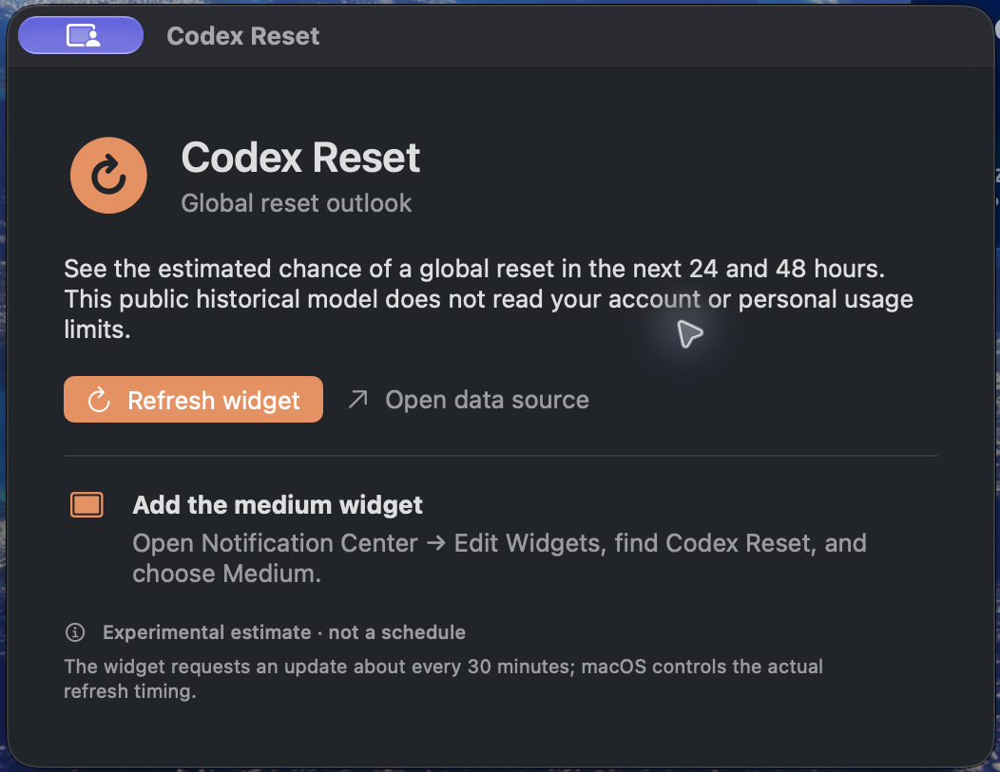

# Codex Reset for macOS

A small native macOS companion app and WidgetKit widget for the public global Codex reset outlook from [codex-reset.com](https://codex-reset.com/).

The medium widget shows the estimated chance of a global reset in the next 24 and 48 hours, the time since the last confirmed reset, and the model confidence. It uses adaptive macOS material, semantic light/dark colors, and a soft orange accent. These are experimental historical estimates, not a reset schedule. Personal `/status` usage stays in Codex; this app does not connect to an OpenAI account or collect credentials.

## Screenshots

### App

### Medium widget

## Download

Download the latest packaged app from [GitHub Releases](https://github.com/kxrxh/codex-reset-macos/releases/latest). Unzip `Codex-Reset-macOS.zip`, then move `Codex Reset.app` to Applications and open it. The package is locally signed and is not notarized, so macOS may ask you to confirm the first launch.

## Run it

1. Open `CodexResetWidget.xcodeproj` in Xcode.
2. Select the `CodexReset` scheme and run it once.
3. Add the **Medium** **Codex Reset** widget from Notification Center → **Edit Widgets**. The small layout is intentionally unavailable so all forecast details remain legible.

The widget reads `https://codex-reset.com/api/forecast`, caches the last successful response on the Mac, and requests a refresh about every 30 minutes. macOS may schedule widget refreshes less often. The widget displays **Data: codex-reset.com** with a direct link as required by the source's public API terms.
